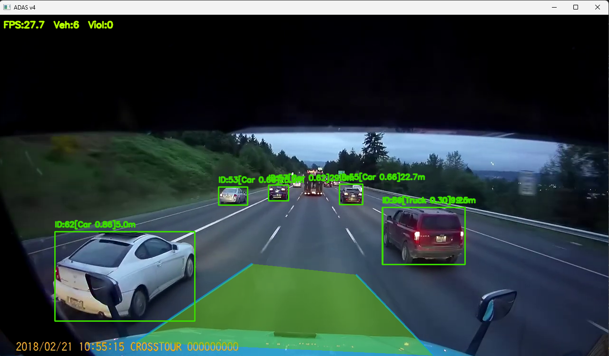
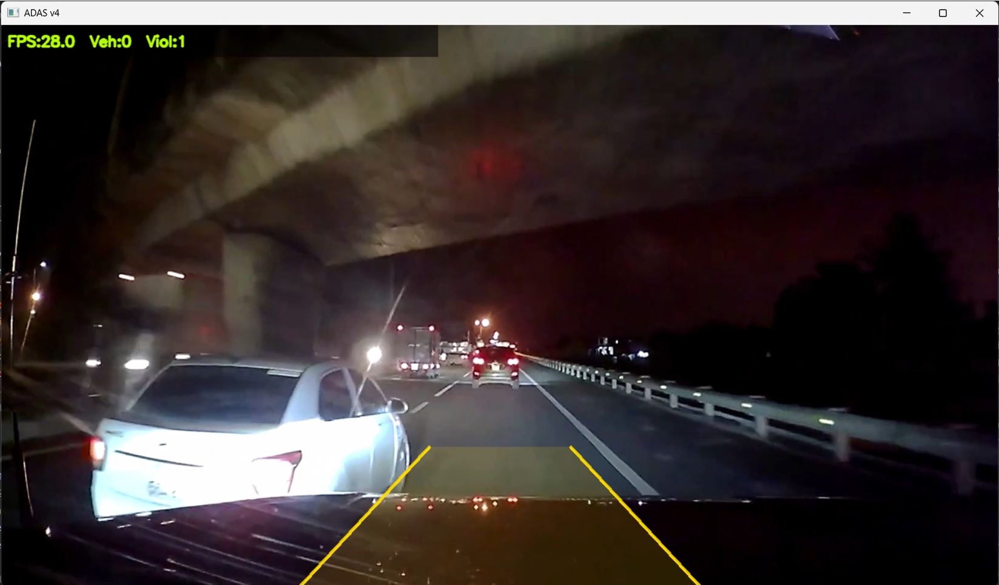
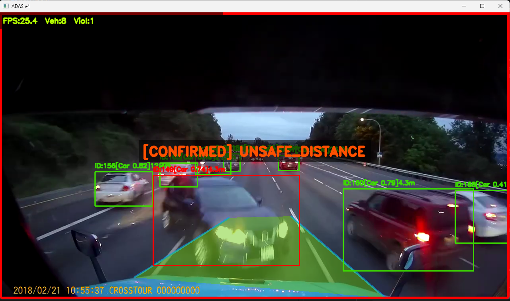
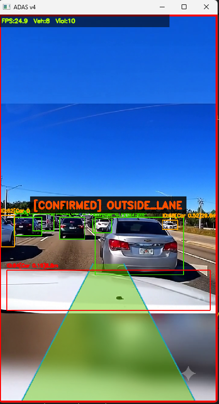
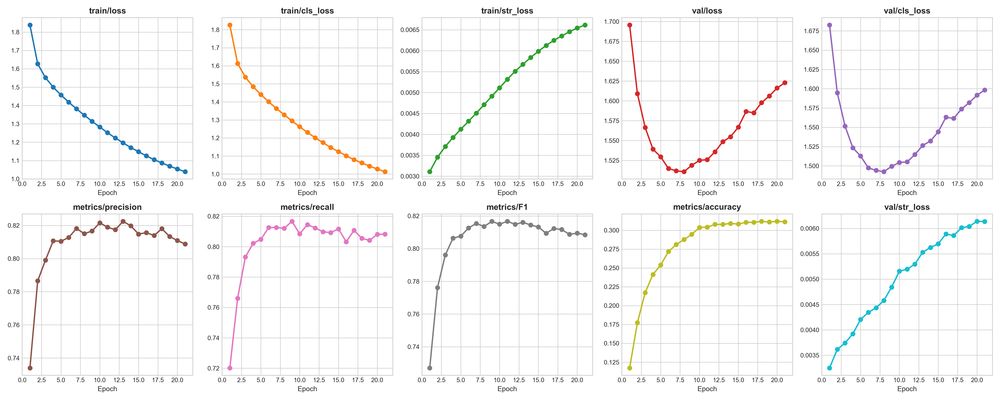
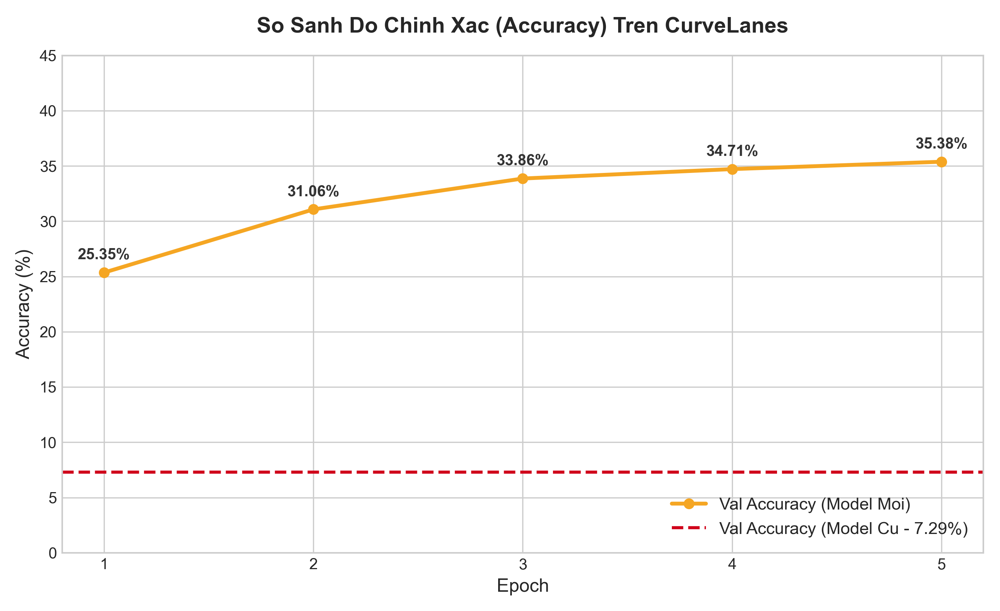

# 🚘 Hệ Thống Giám Sát Vi Phạm Giao Thông Từ Camera Hành Trình

Hệ thống ứng dụng trí tuệ nhân tạo để phát hiện và theo dõi phương tiện từ video camera hành trình. Dự án kết hợp **YOLOv11**, **BYTETrack**, **Kalman Filter** và **UFLD-v2** để nhận diện phương tiện, duy trì ID, phát hiện làn đường, ước tính khoảng cách và cảnh báo các hành vi giao thông nguy hiểm.

## 👤 Người thực hiện

| Họ và tên | MSSV |
|---|---|
| Ngô Long Thiên | 2001230920 |
| Đinh Tấn Phương | 2001230706 |

## 📸 Giao diện và kết quả xử lý

### Giao diện xử lý video

Giao diện Streamlit cho phép lựa chọn hoặc tải video, theo dõi quá trình xử lý và xem thống kê phương tiện, khoảng cách và cảnh báo.

<p align="center">
  
</p>

### Kết quả nhận diện phương tiện và làn đường

Hệ thống hiển thị bounding box, ID theo dõi, khoảng cách ước tính và đường làn trực tiếp trên từng khung hình.

<p align="center">
  
</p>

### Kết quả phát hiện hành vi nguy hiểm

<table>
  <tr>
    <td align="center"><b>Không giữ khoảng cách an toàn</b></td>
    <td align="center"><b>Phương tiện lấn làn</b></td>
  </tr>
  <tr>
    <td>
      
    </td>
    <td>
      
    </td>
  </tr>
</table>

## 🚀 Tính năng chính

### 🚗 Phát hiện và theo dõi phương tiện

- Phát hiện ô tô, xe tải và xe buýt trong video
- Theo dõi phương tiện bằng BYTETrack
- Sử dụng Kalman Filter để duy trì ID ổn định
- Hạn chế đếm trùng khi phương tiện bị che khuất tạm thời

### 🛣️ Nhận diện làn đường

- Nhận diện vạch kẻ đường bằng UFLD-v2
- Xác định vị trí phương tiện so với làn đường
- Phát hiện xe camera đi lệch làn
- Phát hiện phương tiện di chuyển ngoài làn

### 📏 Ước tính khoảng cách

- Ước tính khoảng cách từ camera đến phương tiện phía trước
- Làm mượt kết quả theo thời gian
- Giảm hiện tượng khoảng cách thay đổi đột ngột giữa các khung hình

### ⚠️ Cảnh báo hành vi nguy hiểm

- Giữ khoảng cách không an toàn
- Phương tiện cắt đầu nguy hiểm
- Xe camera đi lệch làn
- Phương tiện di chuyển ngoài làn
- Xác nhận vi phạm qua nhiều khung hình để giảm cảnh báo sai
- Hạn chế ghi nhận trùng vi phạm theo ID phương tiện

### 🖥️ Giao diện Streamlit

- Tải và xử lý video
- Hiển thị kết quả nhận diện trực tiếp
- Theo dõi số phương tiện và số cảnh báo
- Lưu video kết quả, ảnh bằng chứng và báo cáo vi phạm

## 🧠 Quy trình xử lý

```text
Video camera hành trình
        ↓
Tiền xử lý khung hình
        ↓
YOLOv11 phát hiện phương tiện
        ↓
BYTETrack + Kalman Filter theo dõi ID
        ↓
UFLD-v2 nhận diện làn đường
        ↓
Ước tính khoảng cách và phân tích chuyển động
        ↓
Kiểm tra và xác nhận hành vi nguy hiểm
        ↓
Xuất video, ảnh bằng chứng và báo cáo
```

## 🚨 Các loại cảnh báo

| Loại cảnh báo | Mô tả |
|---|---|
| `UNSAFE_DISTANCE` | Phương tiện phía trước ở khoảng cách không an toàn |
| `DANGEROUS_CUT_IN` | Phương tiện chuyển làn và cắt vào phía trước xe camera |
| `EGO_LANE_DEPARTURE` | Xe camera có dấu hiệu đi lệch khỏi làn đường |
| `OUTSIDE_LANE` | Phương tiện di chuyển ra ngoài ranh giới làn đường |

## 📊 Kết quả mô hình

### YOLOv11 nhận diện phương tiện

| Chỉ số | Kết quả |
|---|---:|
| Precision | 80.03% |
| Recall | 59.51% |
| mAP@0.5 | 67.81% |
| mAP@0.5:0.95 | 38.08% |

### UFLD-v2 nhận diện làn đường

| Chỉ số | TuSimple gốc | CurveLanes Fine-tuned |
|---|---:|---:|
| Accuracy | 7.25% | 30.41% |
| Precision | 36.88% | 81.89% |
| Recall | 27.32% | 81.45% |
| F1-score | 31.38% | 81.67% |
| Validation Loss | 2.4799 | 1.5260 |

## 🛠️ Công nghệ sử dụng

| Thành phần | Công nghệ |
|---|---|
| Ngôn ngữ | Python |
| Deep Learning | PyTorch |
| Phát hiện phương tiện | YOLOv11n |
| Theo dõi phương tiện | BYTETrack, Kalman Filter |
| Nhận diện làn đường | UFLD-v2 ResNet-18 |
| Xử lý ảnh và video | OpenCV |
| Xử lý dữ liệu | NumPy, Pandas, SciPy |
| Giao diện | Streamlit |
| Trực quan hóa | Matplotlib |

## ⚙️ Hướng dẫn cài đặt

### Yêu cầu

- Python 3.9 hoặc mới hơn
- Git
- Khuyến nghị GPU NVIDIA hỗ trợ CUDA
- Có thể chạy bằng CPU nhưng tốc độ sẽ chậm hơn

### Các bước cài đặt

#### 1. Clone repository

```bash
git clone https://github.com/Thienshinn1608/Dashcam-traffic-violation-detection.git
cd Dashcam-traffic-violation-detection
```

#### 2. Tạo môi trường ảo

Windows CMD:

```cmd
python -m venv .venv
.venv\Scripts\activate
```

Linux hoặc macOS:

```bash
python3 -m venv .venv
source .venv/bin/activate
```

#### 3. Cài đặt thư viện

```bash
python -m pip install --upgrade pip
pip install -r requirements.txt
```

#### 4. Chuẩn bị model

Trọng số YOLOv11:

```text
runs/detect/fast_adas_model/weights/best.pt
```

Trọng số UFLD-v2:

```text
models/
├── curvelanes_finetuned_best.pth
└── tusimple_18.pth
```

## ▶️ Chạy chương trình

Chạy giao diện Streamlit:

```bash
streamlit run src/app.py
```

Mở trình duyệt tại:

```text
http://localhost:8501
```

Chạy nhận diện làn đường bằng dòng lệnh:

```bash
python detect_video.py --source path/to/video.mp4 --model models/curvelanes_finetuned_best.pth
```

## 📁 Cấu trúc thư mục

```text
Dashcam-traffic-violation-detection/
├── src/
│   ├── app.py                         # Giao diện Streamlit
│   ├── main_pipeline.py               # Pipeline xử lý chính
│   ├── lane_detector.py               # Nhận diện làn đường
│   ├── violation_classifier.py        # Phân loại hành vi nguy hiểm
│   ├── byte_tracker.py                # Theo dõi phương tiện
│   ├── kalman_filter.py               # Bộ lọc Kalman
│   ├── matching.py                    # Ghép detection và track
│   ├── train_lane_curvelanes.py       # Huấn luyện UFLD CurveLanes
│   ├── train_lane_tusimple.py         # Huấn luyện UFLD TuSimple
│   └── eval_lane_model.py             # Đánh giá mô hình làn đường
│
├── models/                             # Model và biểu đồ UFLD
├── runs/detect/fast_adas_model/        # Model và kết quả YOLO
├── anh_thong_so/                       # Biểu đồ đánh giá
├── docs/                               # Ảnh giao diện và kết quả xử lý
│   ├── giao_dien_xu_li.png
│   ├── ket_qua_nhan_dien.png
│   ├── ket_qua_vi_pham_khong_giu_khoang_cach.png
│   └── ket_qua_vi_pham_lan_lan.png
├── output/                              # Video và báo cáo đầu ra
├── detect_video.py                     # Chạy nhận diện bằng CLI
├── train_fast.py                       # Huấn luyện YOLOv11
├── requirements.txt                    # Danh sách thư viện
└── README.md                            # Tài liệu dự án
```

## 📸 Kết quả

### Kết quả huấn luyện YOLOv11

<p align="center">
  
</p>

### So sánh mô hình nhận diện làn đường

<p align="center">
  
</p>

### Ảnh giao diện và kết quả thực tế

Các ảnh minh họa của hệ thống được lưu trong thư mục `docs/` và hiển thị ở phần đầu README:

```text
docs/
├── giao_dien_xu_li.png
├── ket_qua_nhan_dien.png
├── ket_qua_vi_pham_khong_giu_khoang_cach.png
└── ket_qua_vi_pham_lan_lan.png
```

## 👨‍💻 Nội dung thực hiện

- Huấn luyện YOLOv11 để nhận diện phương tiện
- Tích hợp BYTETrack và Kalman Filter để duy trì ID
- Huấn luyện và đánh giá UFLD-v2 cho nhận diện làn đường
- Xây dựng phương pháp ước tính khoảng cách từ camera đơn
- Xây dựng luật phát hiện giữ khoảng cách không an toàn
- Xây dựng luật phát hiện cắt đầu và đi lệch làn
- Áp dụng xác nhận theo thời gian để giảm cảnh báo sai
- Xây dựng giao diện Streamlit để xử lý video và hiển thị kết quả

## 📄 License

Không sử dụng kết quả của hệ thống làm căn cứ xử phạt hoặc cho mục đích thương mại khi chưa được kiểm chứng.
